# Лабораторная работа 2. Простой сайт на Django

**Студент:** Смирнов Фёдор, группа K3340.

**Цель работы:** овладеть практическими навыками и умениями реализации веб-сервисов средствами Django.

**Вариант работы:** 3 - «Табло авиаперелётов». О рейсе хранятся номер, авиакомпания, вылет, прилёт, тип (прилёт или вылет) и номер гейта. Нужно реализовать:

- регистрацию новых пользователей;
- просмотр рейсов и бронирование мест, редактирование и удаление своих броней;
- регистрацию пассажира на рейс и ввод номера его билета администратором средствами Django-admin;
- таблицу всех пассажиров рейса;
- отзывы к рейсам: дата рейса, текст, оценка от 1 до 10, информация об авторе.

Сайт сделан на Django 5.2 и PostgreSQL 17, оформлен на Bootstrap 5. Шаблоны написаны на языке шаблонов Django, у него тот же синтаксис `{{ }}` и ``, что у Jinja2. Код лежит в `students/K3340/Smirnov_Fedor/laboratory_work_2`: проект `airport`, приложение `board`, шаблоны в папке `templates`.

## Запуск

Сайт работает с базой PostgreSQL `airport`, владелец которой - пользователь `airport` с паролем `airport`. Они создаются один раз в psql или pgAdmin от имени `postgres`:

```sql
CREATE USER airport WITH PASSWORD 'airport';
CREATE DATABASE airport OWNER airport;
```

Подключение описано в `settings.py`:

```python
DATABASES = {
    'default': {
        'ENGINE': 'django.db.backends.postgresql',
        'NAME': 'airport',
        'USER': 'airport',
        'PASSWORD': 'airport',
        'HOST': 'localhost',
        'PORT': '5432',
    }
}
```

```text
pip install -r requirements.txt
python manage.py migrate
python manage.py loaddata flights
python manage.py createsuperuser
python manage.py runserver
```

`loaddata` загружает 12 рейсов из `board/fixtures/flights.json`. Сайт открывается по адресу `http://127.0.0.1:8000/`.

## Модель данных

| Модель | Поля | Связи |
|---|---|---|
| `Flight` - рейс | номер, авиакомпания, тип (вылет или прилёт), откуда, куда, время вылета и прилёта, гейт, число мест | - |
| `Booking` - бронь | место, номер билета, отметка о регистрации | рейс и пассажир (`ForeignKey`) |
| `Comment` - отзыв | дата рейса, текст, оценка 1-10 | рейс и автор (`ForeignKey`) |

Пользователь - это стандартная модель Django `User`, имя и фамилия заполняются при регистрации.

Бронь связывает рейс и пользователя, и у этой связи есть свои поля: место, билет и регистрация. `unique_together` не даёт занять одно место рейса дважды. `related_name` задаёт обратные связи: `flight.bookings` - брони рейса, `flight.comments` - его отзывы. Тип рейса хранится кодом `departure` или `arrival`, а на странице выводится подпись «Вылет» или «Прилёт» (`choices`).

```python
from django.conf import settings
from django.db import models


class Flight(models.Model):
    KINDS = (
        ('departure', 'Вылет'),
        ('arrival', 'Прилёт'),
    )

    number = models.CharField('Номер рейса', max_length=10)
    airline = models.CharField('Авиакомпания', max_length=100)
    kind = models.CharField('Тип', max_length=10, choices=KINDS)
    from_city = models.CharField('Откуда', max_length=100)
    to_city = models.CharField('Куда', max_length=100)
    takeoff = models.DateTimeField('Вылет')
    landing = models.DateTimeField('Прилёт')
    gate = models.CharField('Гейт', max_length=5)
    seats = models.PositiveIntegerField('Мест в самолёте')

    class Meta:
        ordering = ['takeoff']
        verbose_name = 'рейс'
        verbose_name_plural = 'рейсы'

    def __str__(self):
        return f'{self.number} {self.from_city} - {self.to_city}'


class Booking(models.Model):
    flight = models.ForeignKey(Flight, on_delete=models.CASCADE, related_name='bookings', verbose_name='Рейс')
    passenger = models.ForeignKey(settings.AUTH_USER_MODEL, on_delete=models.CASCADE, verbose_name='Пассажир')
    seat = models.PositiveIntegerField('Место')
    ticket = models.CharField('Номер билета', max_length=20, blank=True)
    checked_in = models.BooleanField('Зарегистрирован', default=False)

    class Meta:
        unique_together = ['flight', 'seat']
        verbose_name = 'бронь'
        verbose_name_plural = 'брони'

    def __str__(self):
        return f'{self.flight.number}, место {self.seat}'


class Comment(models.Model):
    flight = models.ForeignKey(Flight, on_delete=models.CASCADE, related_name='comments', verbose_name='Рейс')
    author = models.ForeignKey(settings.AUTH_USER_MODEL, on_delete=models.CASCADE, verbose_name='Автор')
    flight_date = models.DateField('Дата рейса')
    text = models.TextField('Комментарий')
    rating = models.PositiveSmallIntegerField('Оценка', choices=[(n, n) for n in range(1, 11)])

    class Meta:
        verbose_name = 'отзыв'
        verbose_name_plural = 'отзывы'

    def __str__(self):
        return f'{self.author} о рейсе {self.flight.number}'
```

## Адреса

| Адрес | Представление | Что делает | Кому доступно |
|---|---|---|---|
| `/` | `board` | табло: поиск, фильтр, страницы | всем |
| `/signup/` | `SignUpView` | регистрация | всем |
| `/accounts/login/`, `/accounts/logout/` | `LoginView`, `LogoutView` из Django | вход и выход | всем |
| `/flights/<id>/` | `flight_page` | рейс, пассажиры, отзывы | всем |
| `/flights/<id>/book/` | `book_seat` | бронь места | вошедшим |
| `/flights/<id>/comment/` | `add_comment` | отзыв | вошедшим |
| `/bookings/` | `my_bookings` | мои брони | вошедшим |
| `/bookings/<id>/change/` | `change_booking` | смена места | владельцу брони до регистрации |
| `/bookings/<id>/cancel/` | `cancel_booking` | отмена брони | владельцу брони до регистрации |
| `/bookings/<id>/check-in/` | `check_in` | билет и регистрация | администратору |
| `/admin/` | Django-admin | управление данными | администратору |

```python
from django.contrib import admin
from django.urls import include, path

urlpatterns = [
    path('admin/', admin.site.urls),
    path('accounts/', include('django.contrib.auth.urls')),
    path('', include('board.urls')),
]
```

```python
from django.urls import path

from . import views

urlpatterns = [
    path('', views.board, name='board'),
    path('signup/', views.SignUpView.as_view(), name='signup'),
    path('flights/<int:pk>/', views.flight_page, name='flight'),
    path('flights/<int:pk>/book/', views.book_seat, name='book_seat'),
    path('flights/<int:pk>/comment/', views.add_comment, name='add_comment'),
    path('bookings/', views.my_bookings, name='my_bookings'),
    path('bookings/<int:pk>/change/', views.change_booking, name='change_booking'),
    path('bookings/<int:pk>/cancel/', views.cancel_booking, name='cancel_booking'),
    path('bookings/<int:pk>/check-in/', views.check_in, name='check_in'),
]
```

## Табло: поиск, фильтр и страницы

`board` берёт все рейсы и сужает выборку по параметрам запроса. Параметр `q` ищет текст в номере рейса, авиакомпании и обоих городах сразу: условия объединены через `Q` и `|`, то есть через «или». `icontains` ищет вхождение без учёта регистра. Параметр `kind` оставляет только вылеты или только прилёты. `Paginator` делит результат на страницы по 5 рейсов, а `get_page` возвращает страницу с номером из параметра `page`.

```python
def board(request):
    flights = Flight.objects.all()
    query = request.GET.get('q', '')
    kind = request.GET.get('kind', '')
    if query:
        flights = flights.filter(
            Q(number__icontains=query) | Q(airline__icontains=query)
            | Q(from_city__icontains=query) | Q(to_city__icontains=query)
        )
    if kind:
        flights = flights.filter(kind=kind)
    page = Paginator(flights, 5).get_page(request.GET.get('page'))
    return render(request, 'board.html', {'page': page, 'query': query, 'kind': kind})
```

В ссылках «Назад» и «Вперёд» повторяются `q` и `kind`, поэтому при переходе на другую страницу поиск и фильтр сохраняются:

```html
<ul class="pagination">
    
        <li class="page-item">
            <a class="page-link" href="?page={{ page.previous_page_number }}&q={{ query|urlencode }}&kind={{ kind }}">Назад</a>
        </li>
    
    <li class="page-item disabled">
        <span class="page-link">Страница {{ page.number }} из {{ page.paginator.num_pages }}</span>
    </li>
    
        <li class="page-item">
            <a class="page-link" href="?page={{ page.next_page_number }}&q={{ query|urlencode }}&kind={{ kind }}">Вперёд</a>
        </li>
    
</ul>
```

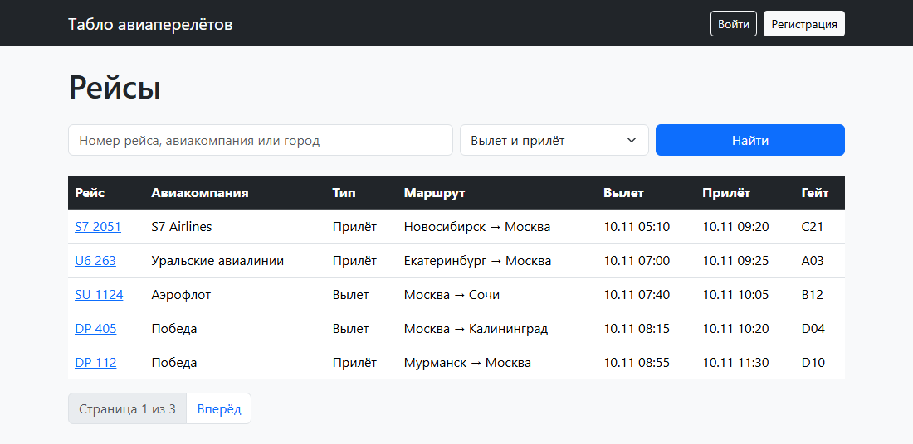

Поиск «москва» с фильтром «Только вылет», вторая страница:

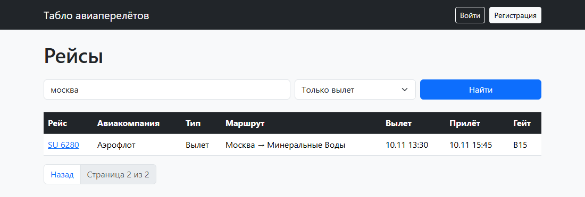

## Регистрация и вход

Форма регистрации наследует `UserCreationForm` и добавляет к логину имя и фамилию. `SignUpView` - представление на основе класса `CreateView`: оно показывает форму, сохраняет пользователя и перенаправляет на страницу входа. Вход и выход - готовые представления Django, подключённые строкой `include('django.contrib.auth.urls')`.

```python
class SignUpForm(UserCreationForm):
    class Meta(UserCreationForm.Meta):
        fields = ['username', 'first_name', 'last_name']
```

```python
class SignUpView(CreateView):
    form_class = SignUpForm
    template_name = 'registration/signup.html'
    success_url = reverse_lazy('login')
```

Меню в `base.html` зависит от пользователя: гость видит «Войти» и «Регистрация», вошедший - «Мои брони» и «Выйти», администратор ещё и ссылку на Django-admin.

```html
<nav class="navbar navbar-dark bg-dark mb-4">
    <div class="container">
        <a class="navbar-brand" href="">Табло авиаперелётов</a>
        <div class="d-flex align-items-center gap-2">
            
                <a class="btn btn-outline-light btn-sm" href="">Мои брони</a>
                
                    <a class="btn btn-warning btn-sm" href="">Django-admin</a>
                
                <span class="text-light">{{ user.username }}</span>
                <form method="post" action="">
                    
                    <button class="btn btn-outline-light btn-sm">Выйти</button>
                </form>
            
                <a class="btn btn-outline-light btn-sm" href="">Войти</a>
                <a class="btn btn-light btn-sm" href="">Регистрация</a>
            
        </div>
    </div>
</nav>
```

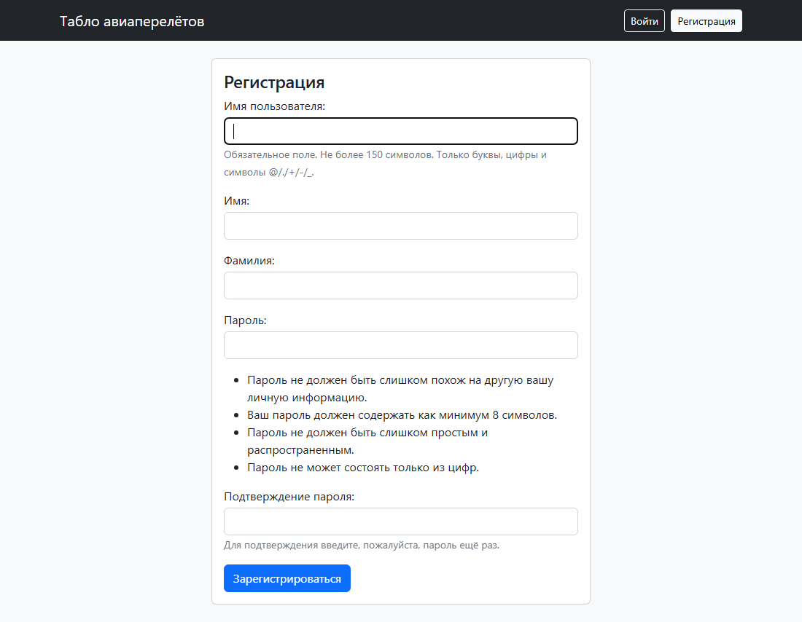

## Страница рейса и таблица пассажиров

`flight_page` передаёт в шаблон рейс, его брони и отзывы. `select_related` загружает пассажиров и авторов тем же запросом через JOIN, а не отдельным запросом на каждую строку таблицы. Свободные места - число мест минус число броней.

```python
def flight_page(request, pk):
    flight = get_object_or_404(Flight, pk=pk)
    passengers = flight.bookings.select_related('passenger').order_by('seat')
    comments = flight.comments.select_related('author').order_by('-id')
    context = {
        'flight': flight,
        'passengers': passengers,
        'comments': comments,
        'free': flight.seats - passengers.count(),
    }
    return render(request, 'flight.html', context)
```

Обычный пользователь видит в таблице место и имя пассажира. Администратор видит ещё номер билета, отметку о регистрации и кнопку «Зарегистрировать». Разграничение сделано проверкой `user.is_staff` в шаблоне:

```html
<h2>Пассажиры рейса</h2>
<table class="table bg-white mb-4">
    <thead>
    <tr>
        <th>Место</th>
        <th>Пассажир</th>
        
            <th>Номер билета</th>
            <th>Регистрация</th>
            <th></th>
        
    </tr>
    </thead>
    <tbody>
    
        <tr>
            <td>{{ booking.seat }}</td>
            <td>{{ booking.passenger.get_full_name|default:booking.passenger.username }}</td>
            
                <td>{{ booking.ticket|default:'-' }}</td>
                <td>зарегистрированнет</td>
                <td><a class="btn btn-warning btn-sm" href="">Зарегистрировать</a></td>
            
        </tr>
    
        <tr><td colspan="5">Мест пока никто не бронировал</td></tr>
    
    </tbody>
</table>
```

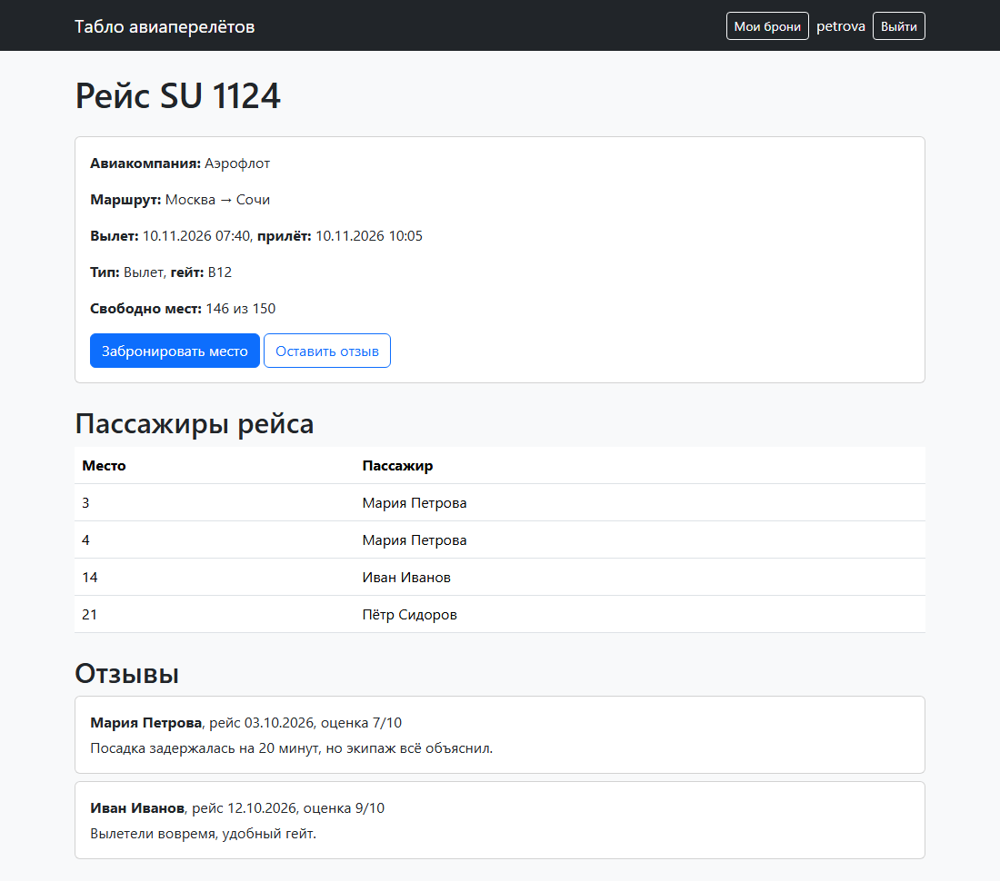

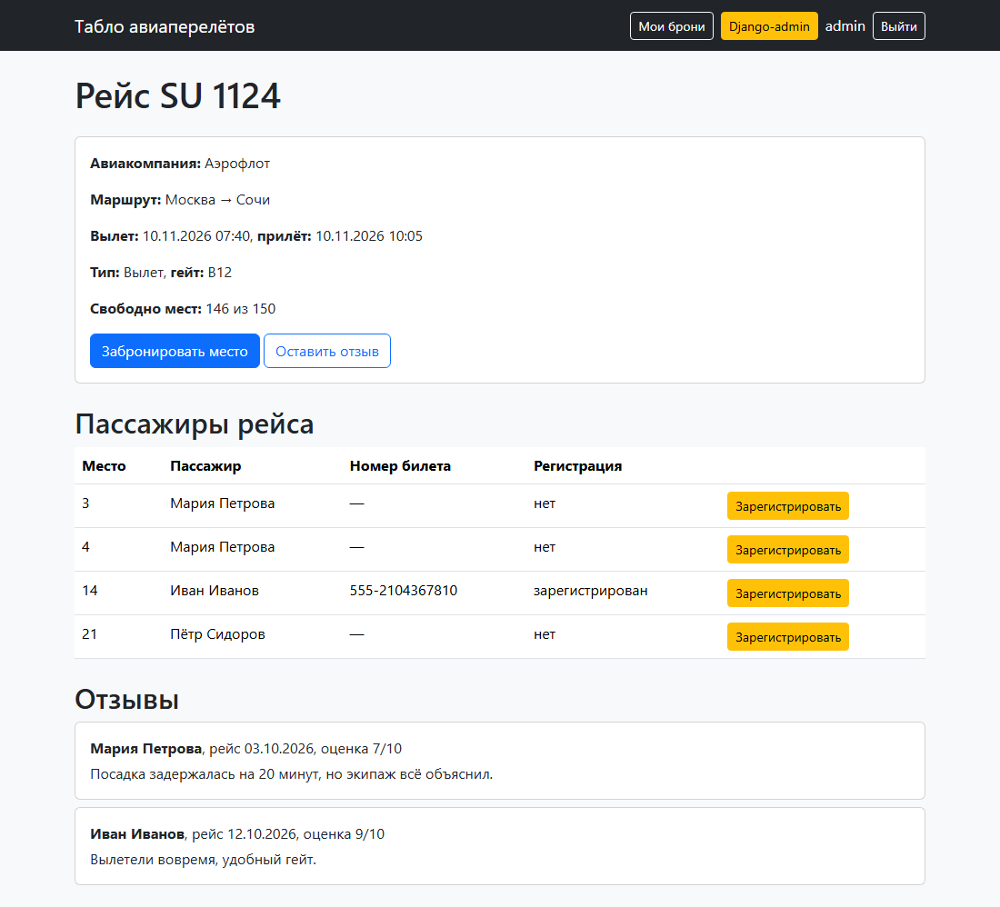

## Бронирование мест

В форму брони передаётся заготовка `Booking(flight=flight, passenger=request.user)` как `instance`. Пользователь вводит только место, а рейс и пассажира подставляет сервер. `clean_seat` проверяет, что такое место есть в самолёте и оно свободно. `exclude(pk=self.instance.pk)` не считает занятым место самой брони, поэтому при редактировании можно оставить прежнее.

```python
class BookingForm(forms.ModelForm):
    class Meta:
        model = Booking
        fields = ['seat']

    def clean_seat(self):
        seat = self.cleaned_data['seat']
        flight = self.instance.flight
        if seat < 1 or seat > flight.seats:
            raise forms.ValidationError(f'Выберите место от 1 до {flight.seats}')
        if flight.bookings.filter(seat=seat).exclude(pk=self.instance.pk).exists():
            raise forms.ValidationError('Это место уже занято')
        return seat
```

```python
@login_required
def book_seat(request, pk):
    flight = get_object_or_404(Flight, pk=pk)
    booking = Booking(flight=flight, passenger=request.user)
    if request.method == 'POST':
        form = BookingForm(request.POST, instance=booking)
        if form.is_valid():
            form.save()
            return redirect('my_bookings')
    else:
        form = BookingForm(instance=booking)
    return render(request, 'booking_form.html', {'form': form, 'flight': flight})


@login_required
def my_bookings(request):
    bookings = Booking.objects.filter(passenger=request.user).select_related('flight').order_by('flight__takeoff', 'seat')
    return render(request, 'my_bookings.html', {'bookings': bookings})


@login_required
def change_booking(request, pk):
    booking = get_object_or_404(Booking, pk=pk, passenger=request.user, checked_in=False)
    if request.method == 'POST':
        form = BookingForm(request.POST, instance=booking)
        if form.is_valid():
            form.save()
            return redirect('my_bookings')
    else:
        form = BookingForm(instance=booking)
    return render(request, 'booking_form.html', {'form': form, 'flight': booking.flight})


@login_required
def cancel_booking(request, pk):
    booking = get_object_or_404(Booking, pk=pk, passenger=request.user, checked_in=False)
    if request.method == 'POST':
        booking.delete()
        return redirect('my_bookings')
    return render(request, 'booking_cancel.html', {'booking': booking})
```

`@login_required` отправляет гостя на страницу входа. `get_object_or_404(Booking, pk=pk, passenger=request.user, checked_in=False)` находит бронь, только если она принадлежит текущему пользователю и он ещё не зарегистрирован на рейс, иначе возвращается 404.

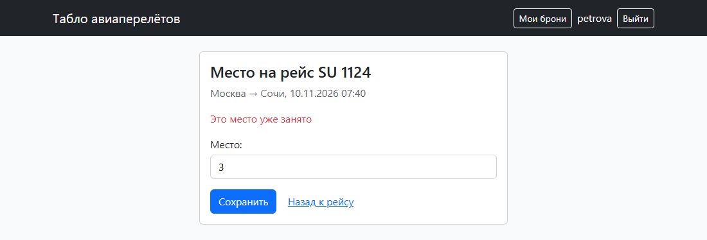

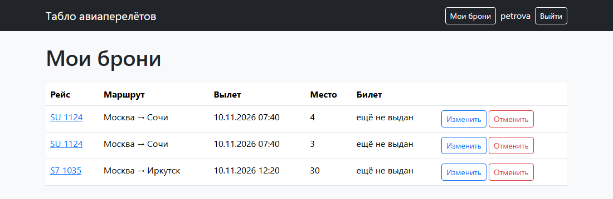

После регистрации на рейс в брони появляется номер билета, а кнопки «Изменить» и «Отменить» пропадают:

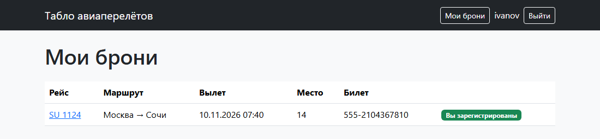

## Отзывы

В форме отзыва три поля: дата рейса, оценка и текст. Оценка задана через `choices` от 1 до 10, поэтому на странице это выпадающий список, и другое значение форма не примет. Для даты браузер показывает календарь (`type="date"`). Рейс и автор подставляются так же, как в брони, а на странице рейса рядом с отзывом выводятся имя автора, дата рейса и оценка.

```python
class CommentForm(forms.ModelForm):
    class Meta:
        model = Comment
        fields = ['flight_date', 'rating', 'text']
        widgets = {'flight_date': forms.DateInput(attrs={'type': 'date'})}
```

```python
@login_required
def add_comment(request, pk):
    flight = get_object_or_404(Flight, pk=pk)
    comment = Comment(flight=flight, author=request.user)
    if request.method == 'POST':
        form = CommentForm(request.POST, instance=comment)
        if form.is_valid():
            form.save()
            return redirect('flight', pk=pk)
    else:
        form = CommentForm(instance=comment)
    return render(request, 'comment_form.html', {'form': form, 'flight': flight})
```

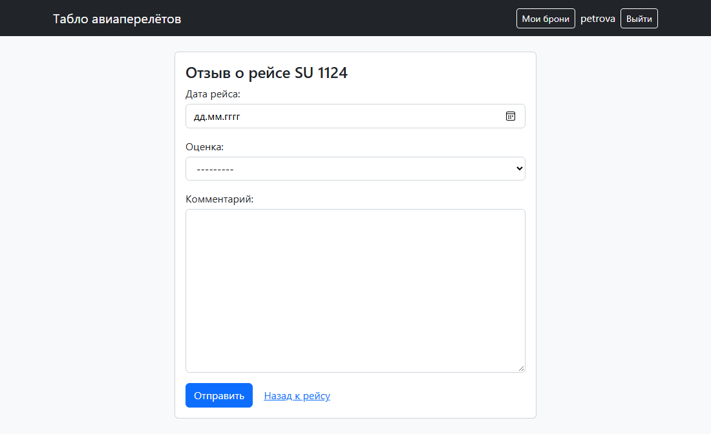

## Регистрация пассажира и номер билета

В Django-admin рейс открывается вместе со своими бронями: `BookingInline` выводит их таблицей на странице рейса. Там администратор добавляет пассажира на место, вписывает номер билета и ставит отметку «Зарегистрирован». В списках настроены колонки (`list_display`), фильтры (`list_filter`) и поиск (`search_fields`).

```python
from django.contrib import admin

from .models import Booking, Comment, Flight


class BookingInline(admin.TabularInline):
    model = Booking
    extra = 1


class FlightAdmin(admin.ModelAdmin):
    list_display = ['number', 'airline', 'kind', 'from_city', 'to_city', 'takeoff', 'gate']
    list_filter = ['kind', 'airline']
    search_fields = ['number', 'airline', 'from_city', 'to_city']
    inlines = [BookingInline]


class BookingAdmin(admin.ModelAdmin):
    list_display = ['flight', 'passenger', 'seat', 'ticket', 'checked_in']
    list_filter = ['checked_in', 'flight']


class CommentAdmin(admin.ModelAdmin):
    list_display = ['flight', 'author', 'flight_date', 'rating']


admin.site.register(Flight, FlightAdmin)
admin.site.register(Booking, BookingAdmin)
admin.site.register(Comment, CommentAdmin)
```

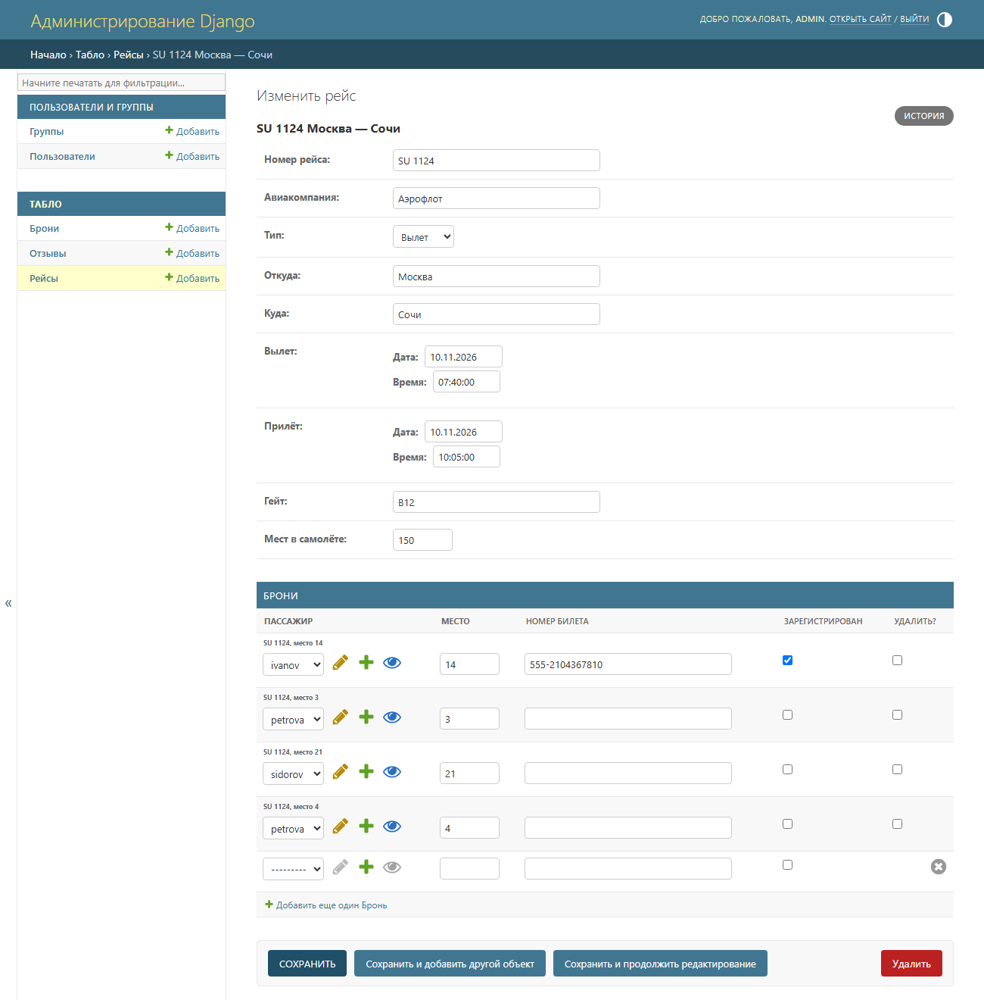

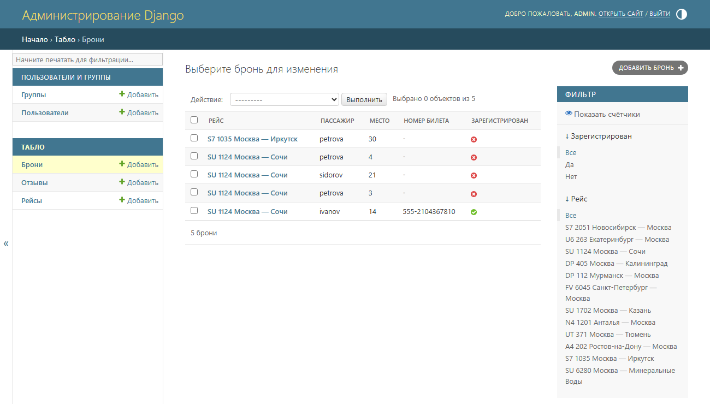

То же администратор может сделать на сайте: кнопка «Зарегистрировать» в таблице пассажиров открывает форму `check_in`. Декоратор `@staff_member_required` пускает на неё только пользователей с `is_staff`.

```python
class TicketForm(forms.ModelForm):
    class Meta:
        model = Booking
        fields = ['ticket', 'checked_in']
```

```python
@staff_member_required
def check_in(request, pk):
    booking = get_object_or_404(Booking, pk=pk)
    if request.method == 'POST':
        form = TicketForm(request.POST, instance=booking)
        if form.is_valid():
            form.save()
            return redirect('flight', pk=booking.flight.pk)
    else:
        form = TicketForm(instance=booking)
    return render(request, 'check_in.html', {'form': form, 'booking': booking})
```

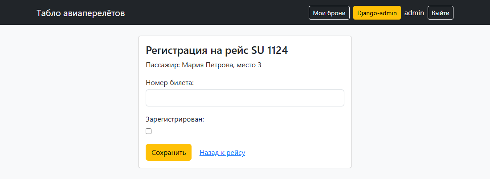

## Вывод

Сайт построен по схеме Django «модель - представление - шаблон». Модели описывают рейсы, брони и отзывы, а таблицы в PostgreSQL по ним создают миграции. Представления получают запрос, обращаются к базе через ORM и отдают шаблон с данными, а адреса в `urls.py` связывают URL с представлениями. Формы на основе `ModelForm` проверяют ввод: место должно быть в самолёте и свободно, оценка - от 1 до 10. Права разделены на трёх уровнях: гость только смотрит, вошедший пользователь бронирует места и пишет отзывы, а администратор в браузере и в Django-admin видит билеты и регистрирует пассажиров. Табло поддерживает поиск, фильтр по типу рейса и разбивку на страницы.
